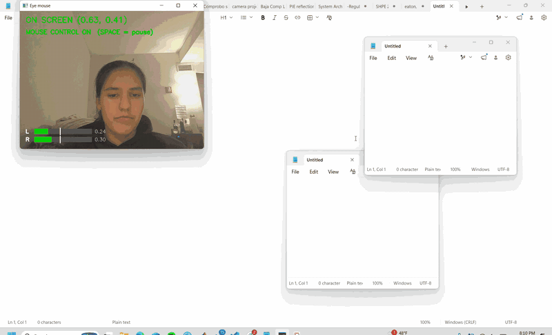
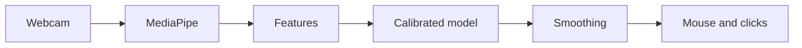
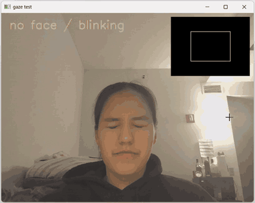

# Eye-tracking mouse

**Akil Pugalenthi and Pia Swarup**

Computational Introduction to Robotics

**[The full demo video can be found here](docs/videos/full_demo.mp4)**

## Goal

The goal for this project is to control your mouse with your eyes using only a laptop webcam. We also wanted to be able to click, so a left wink does a left click and a right wink does a right click. This is important for accessibility reasons, such as making computers easier to use for people with conditions like ALS, paralysis, or repetitive strain injury (RSI). Additionally, existing eye tracking devices are very expensive, and using a laptop webcam would be free. This also set the main constraint of our project: the only sensor is a built-in laptop webcam, which gives us 640×480 video at 30 frames per second.

## Approach

### System overview

The input for the model is the laptop or computer's webcam, which in our case gives 640×480 video at 30 frames per second. Each frame is first flipped horizontally so it works like a mirror. Then, we use Google's MediaPipe Face Landmarker on every frame to give us 478 points on the face, including the irises. MediaPipe is a machine learning model that has already been trained on extensive data sets, so we did not do any training ourselves for this landmark detection. We also get 52 blendshape scores between 0 and 1 that describe facial movements, like how far each eye is looking left, right, up or down, and how closed each eye is. We use the eye closed scores later to detect winks. We also get a matrix describing the orientation of the head.

### Data collection for the model

The first step is calibrating the model to the user's face with `calibration.py`. This is the data collecting stage. When we run it, it measures the screen size, opens the webcam and starts the MediaPipe Face Landmarker. Then an instruction screen pops up that guides the user through a 3 phase setup to record different instances of the face:

1. The first phase asks the user to look at red dots, one at a time, in a 3×3 grid across the screen.
2. The second phase asks the user to look at 5 dots across the screen while slowly moving their head.
3. The third phase shows arrows pointing past the screen's edges and corners, and asks the user to look about 1 inch past the tip of each arrow and hold until they hear a beep.

Each target starts with a short wait so the user's eyes can settle on it before anything is recorded. This is 1 second for dots and 2.5 seconds for arrows, since the user has to read the arrow first. Then the frames are recorded for 3 seconds, or 6 seconds for the head movement dots. On the dots, a ring shrinks around the dot during recording so the user knows how much longer to keep looking.

Each camera frame recorded during this time is stored in a row with the target's known position, whether the target was on screen or not, and whether a face was detected. If a face was detected, then all 478 face landmarks, 52 blendshape scores, and the 16 values of the head pose matrix are recorded too. When the script is done, it saves everything in a time stamped CSV file (one frame per row), along with a JSON file with metadata such as screen size, camera resolution and timing settings, in the `calibration_data` folder. These files are then used to train the gaze model, which learns how to map the user's face to a screen position for the mouse.

### Gaze features

Next, we reduce the MediaPipe output to 4 numbers. `look_right` and `look_up` are found by combining the eye blendshapes from both eyes. `head_yaw` and `head_pitch` describe how far the head is turned left or right and tilted up or down. We found that it is very important to include head rotation, because when the user turns their head but keeps looking at the same spot, their eyes rotate the other way. Therefore, the rotation of the eyes relative to the head is needed to figure out where the user is looking. 

### Gaze model

We use a quadratic regression, fitted with least squares, to turn the four features into x and y coordinates on the screen. Quadratic means the model also uses the squares of the features and the products of each pair, so the mapping can curve instead of being a straight line. We chose this because a linear fit did not work well when the head turned far. We tested this by leaving one target out of the fit and predicting it. With the head moving, the quadratic fit lowered the error from 231 to 194 pixels, and off screen detection rose from 68.5% to 89.1%. The model is fitted on every frame from the on screen parts of calibration, not just one average per dot. That way the frames from the second phase, where the head is moving, teach it how to correct for head turns.

When `main.py` starts, it checks for the newest complete calibration and refits the model automatically if needed.

### On screen vs off screen

The model also tells whether the user is looking at the screen at all. If the predicted position is inside the screen, plus a small 3% margin, the user is looking at the screen. Otherwise they are looking away. To stop it from flickering when the user looks near an edge, the state only changes after 5 frames in a row agree. The off screen targets from calibration are not used to fit the model. Instead, we use them to test how well this check works.

In the recording below, the white box in the top right is the screen and the dot is where the model thinks the user is looking. The dot is green while the user looks at the screen and turns red when they look away.

[The full video can be viewed here](docs/videos/boundary_demo.mp4)

### Smoothing

The raw prediction from the gaze model jittered by about 60 pixels even when the user's eyes were still, so we smooth it in two steps. First, we use a One Euro filter (Casiez et al., 2012), which smooths heavily when the gaze barely moves and lightly when it moves fast. This keeps the cursor steady when the user looks at something, and it still responds quickly when they look somewhere new. On its own, it cut the jitter from about 60 to about 28 pixels.

Second, the cursor ignores changes smaller than 25 pixels, glides toward the new point over about 0.2 seconds instead of jumping, and has a top speed of 900 pixels per second. In an earlier test with a 50 pixel deadzone, the cursor moved 5 times while the user stared at one spot for 3 seconds, compared to 68 times with no deadzone.

### Mouse movement and clicking

To move the real cursor, we use pyautogui, a Python library that controls the mouse. Our `MouseMovement` class (in `mouse_movement.py`) takes the smoothed gaze point, which is a fraction of the screen from 0 to 1, and turns it into pixels. A sensitivity setting can stretch the point away from the center of the screen to make the edges easier to reach, but we left it at 1. The cursor is kept 1 pixel away from the edges, because pyautogui has a fail-safe that stops the program if the mouse hits a corner. We kept that fail-safe on purpose as an emergency stop: pushing the real mouse into a corner ends the program. The program starts paused, and the cursor only follows the user's eyes after they press SPACE.

For clicking, `click_detector.py` uses MediaPipe's eye closed score for each eye, where 0 is open and 1 is closed. A wink counts when one eye scores above 0.45, is at least 0.2 more closed than the other eye, and stays that way for 0.25 seconds. A left wink is a left click and a right wink is a right click. Normal blinks don't click, because both eyes close about the same amount and only for about 0.1 to 0.15 seconds. After each click there is a 0.6 second cooldown, so one long wink can't click twice. Clicks only happen while the user has control turned on.

## Important design decisions

An important design decision was what to measure the gaze relative to. We started with the midpoint between the two irises in the camera image, but that point also moves when the head moves. During our first calibration, the head drifted about 0.8 cm, which was about as large as the whole range of eye movement across the screen. This gave us a result that looked too good to be true. The iris midpoint seemed to detect off screen gaze 100% of the time, but when we checked where it thought the user was looking, the directions were wrong. It was really detecting that the head had drifted by the time the off screen part was recorded.

Next, we tried measuring the irises relative to 10 different points on the face, including the nose tip, nose bridge, brows, forehead, chin, temples and eye corners. None of these helped. The nose tip was the worst and made the error about twice as large, because it sticks out from the face and swings the most when the head turns.

In the end, we used MediaPipe's eye blendshapes, which already describe where the eyes are pointing relative to the head, together with the head rotation, in a quadratic model. On our first recording, adding head rotation to the blendshapes raised off screen detection from 67.8% to 98.0%.

## Challenges faced along the way

- **Head movement:** Our first model used the center point between the irises. It drew a bounding box around where that point went during calibration and turned the point's position into mouse movements. The problem was that this point moves when the head moves, not just when the eyes move, so tilting or shifting the head made the cursor jump across the screen. Measuring the irises relative to other facial features didn't fix it. What worked was switching to MediaPipe's eye blendshapes plus the head rotation, fitted to the screen with least squares regression (see Important design decisions). Head movement still isn't fully solved: when the head moves, the cursor is off by about 10% of the screen, compared to about 6% when the head is still.
- **Smoothing the cursor movement:** At first, the cursor jumped straight to each new gaze point, which made it move in a jerky, stop motion way. To fix this, we added easing to the `MouseMovement` class. Every frame, it compares where the cursor is now with where the gaze says it should be, and moves part of the way there. When the target is far away the cursor moves fast, and as it gets close it slows down. This got rid of the jerky movement and made the cursor glide. The downside is a small delay of about 0.2 seconds, so we had to balance smoothness against how quickly the cursor responds.
- **Winking to click:** Our first click detector looked for one eye closed and the other open, but it never triggered on real winks. We wrote `wink_test.py` to record real winks and blinks, and found that the other eye squints too when you wink: the winking eye scored about 0.6 and the open eye about 0.3. We changed the detector to compare the two eyes, so a wink is when one eye is clearly more closed than the other, and it has to last at least 0.25 seconds so that normal blinks don't click. Left and right clicks were also swapped at first because the camera image is mirrored. The wink test suggested one setting, but testing it live showed the opposite, so we went with the live result.

## Improvements with more time

- **Reduce cursor movement with head tilt:** Currently we feed head yaw and pitch into the model, but it doesn't take into account sideways tilt or where the head is (leaning in, out or to the side). Calibration also only records a few head movements in a short period of time. With more time, we would make calibration longer to record more head movements, and add sideways tilt and head position to the model, so that the cursor doesn't shift when the user moves their head.
- **Handle different distances from the screen:** The current model depends a lot on how far the user is from the camera and where the camera is relative to the user. With more time, we would record calibration at two or three distances, add a distance estimate (for example from the size of the face in the image), or automatically rescale the prediction as the user moves closer or farther away. This would mean the user doesn't have to recalibrate every time they use the program.
- **Make the cursor snap to clickable areas on the screen:** Our webcam gaze is usually off by about 6 to 10% of the screen, which is around 100 pixels or more. This makes it hard to click small buttons and links, especially near the edges and corners of the screen. So that the user doesn't have to strain their eyes, we would add a feature where the cursor snaps to the nearest clickable element when it gets close.
- **Calibrate winks for each user:** Right now a wink has to last 0.25 seconds with fixed thresholds for everyone. For accessibility this isn't ideal, because people wink differently and some people can't wink at all, which can cause missed or unintended clicks. With more time, we would add a wink step to calibration that sets the hold time and thresholds for each user, and add dwell clicking (looking at one spot for a set time) as an option for people who can't wink.
- **Better off screen targets:** "Look about 1 inch past the arrow" is only a guess at where the user is looking, so our off screen labels aren't exact. Putting physical markers like sticky notes around the screen would give exact positions and should improve off screen detection, which is only 73% on our latest calibration.

## Lessons learned

We learned that values like thresholds should come from real data instead of guesses. For the wink detector, we recorded real winks and blinks and picked the thresholds from those numbers. That made winks actually work and kept blinks from clicking: across about 5,700 frames with no winks, it made 0 false clicks.

We also learned that building tools to see what the program is doing makes testing much easier. For example, we drew bars on the camera feed showing how closed each eye was, so we could see right away why a wink did or didn't click.

We learnt that testing on targets that were not used to fit the model is very important to catch errors like effects of head moving on cursor drift.

Lastly, While working together we learned to keep generated and personal files out of git. Our calibration recordings were 30 to 70 MB each and different for every person, and the model file was regenerated on every run, which caused merge conflicts. Adding them to `.gitignore` and pulling often from the start would have saved us time.

## Relation to real robotic systems

There are several ways this project relates to real robotic systems. First, we used a One Euro filter and had to make a tradeoff between jitter and lag, which is a trade off often made when filtering for robot state estimation. A real world application of this project other than moving a computer cursor on a screen could be to improve human-robot interactions. The robot can gain a lot of information when knowing where a person is looking. The robot could figure out contextual clues and understand or perform actions based on where a person is looking. Additionally, a similar implementation could be used for hands-free control of robots or other devices. Additionaly, our pipeline is a quite common perception pipeline used in multiple other robotic systems to convert a robot's perception to action. The loop works like this: camera to model to features to control. There are other implementations that already exist such as driver monitoring in cars and eye tracking in VR headsets.

## Gen AI usage

We utilized AI in helping understand external libraries such as OpenCV and pyautogui and suggest functions and code structure. We also used it to generate docstrings for methods in the library as well. We also used Gen AI to debug console error messages to fix code. Gen AI was also used to find and help fix grammatical, syntax and typo errors.

## Demo

1. Install the requirements with `pip install -r requirements.txt`, then download [face_landmarker.task](https://storage.googleapis.com/mediapipe-models/face_landmarker/face_landmarker/float16/1/face_landmarker.task) and put it in the project folder.
2. Run `python calibration.py`, then `python main.py`.
3. The program starts paused. Press SPACE to start or pause control, and q to quit.
4. Wink to click: a left wink is a left click and a right wink is a right click. If needed push the real mouse into a corner of the screen to stop the program.

| File | What it does |
|---|---|
| `calibration.py` | runs the 3 phase calibration and saves the data |
| `gaze_boundary.py` | fits the gaze model and maps the face to a screen position |
| `main.py` | runs everything live: moves the mouse and clicks |
| `mouse_movement.py` | moves the cursor smoothly with pyautogui |
| `click_detector.py` | detects winks and turns them into clicks |
| `wink_test.py` | records winks and blinks to tune the click thresholds |
| `test_calibration.py` | checks the calibration screens and the camera |

**To view our testing and debugging tools run the following:**

`python gaze_boundary.py --live`: the screen box and gaze dot, without moving the mouse.

`python gaze_boundary.py`: refits the model and prints its accuracy on targets it hasn't seen. Add --linear or --eyes-only to compare against simpler previous models.

`python wink_test.py`: records winks and blinks and prints the scores used to pick the thresholds.

`python test_calibration.py`: shows each calibration screen, then runs a camera test.

## References

- [MediaPipe Face Landmarker](https://ai.google.dev/edge/mediapipe/solutions/vision/face_landmarker)
- Casiez, G., Roussel, N. and Vogel, D. (2012). 1€ Filter: A Simple Speed-based Low-pass Filter for Noisy Input in Interactive Systems. *CHI 2012*.
